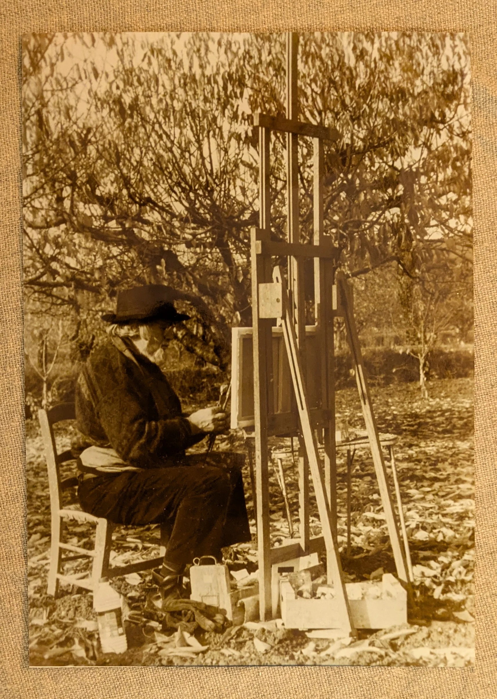
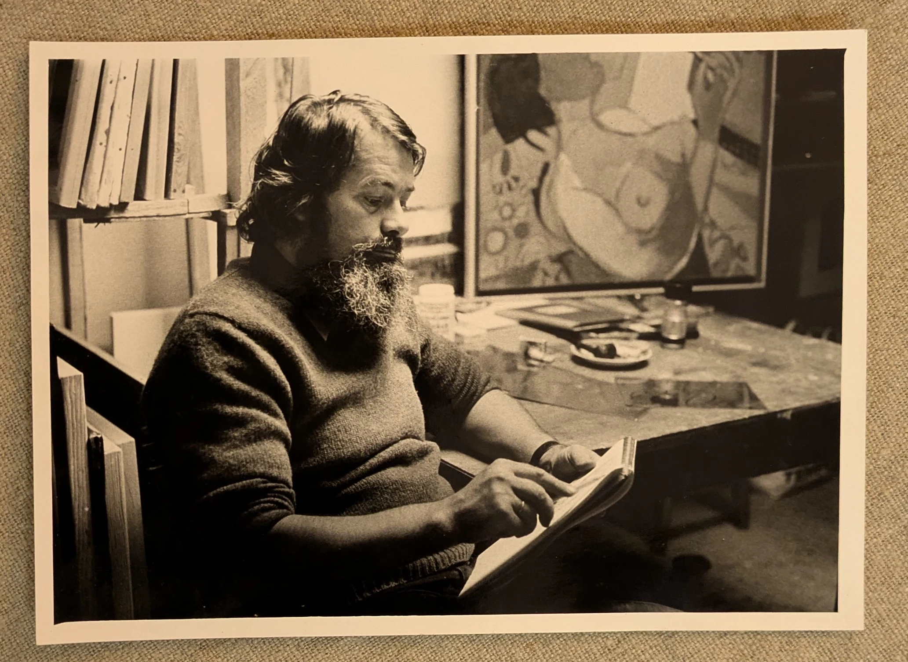
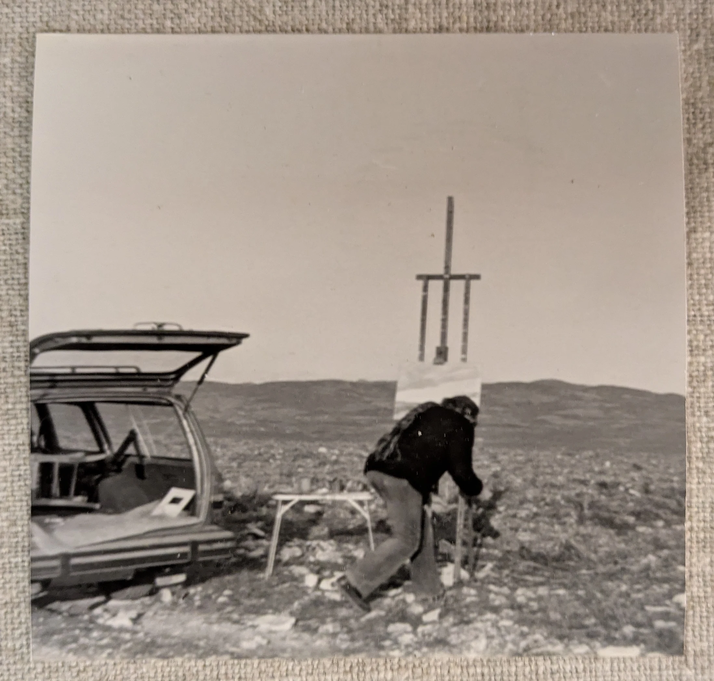
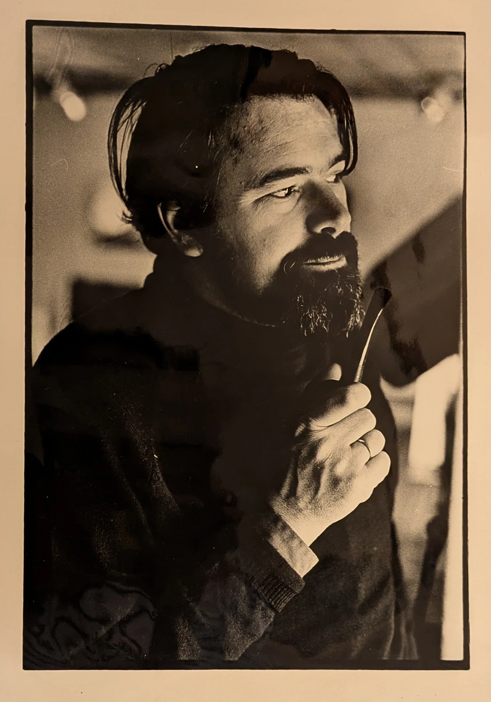
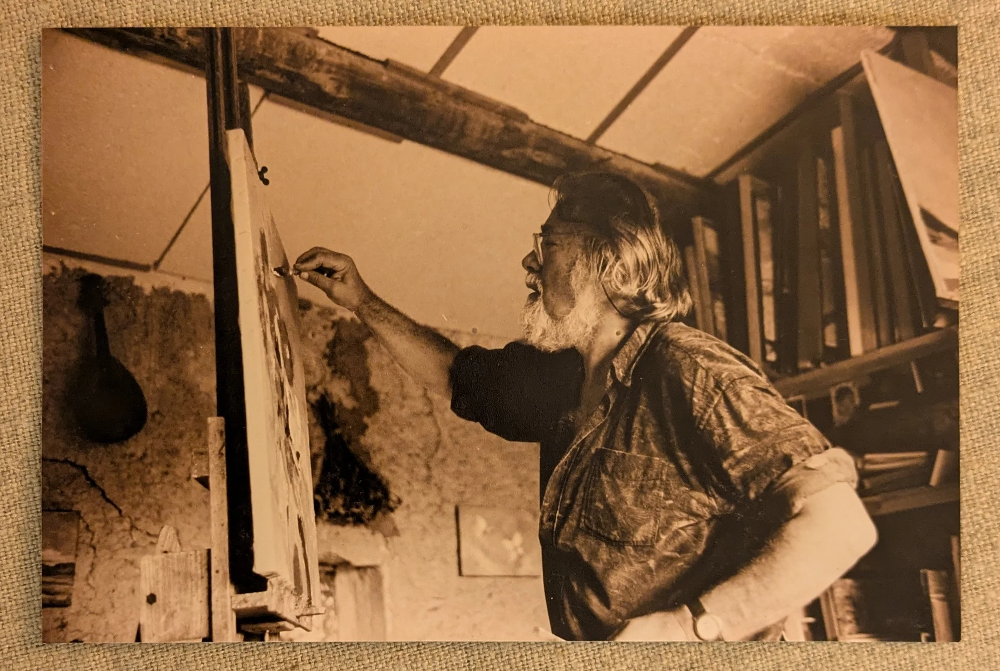
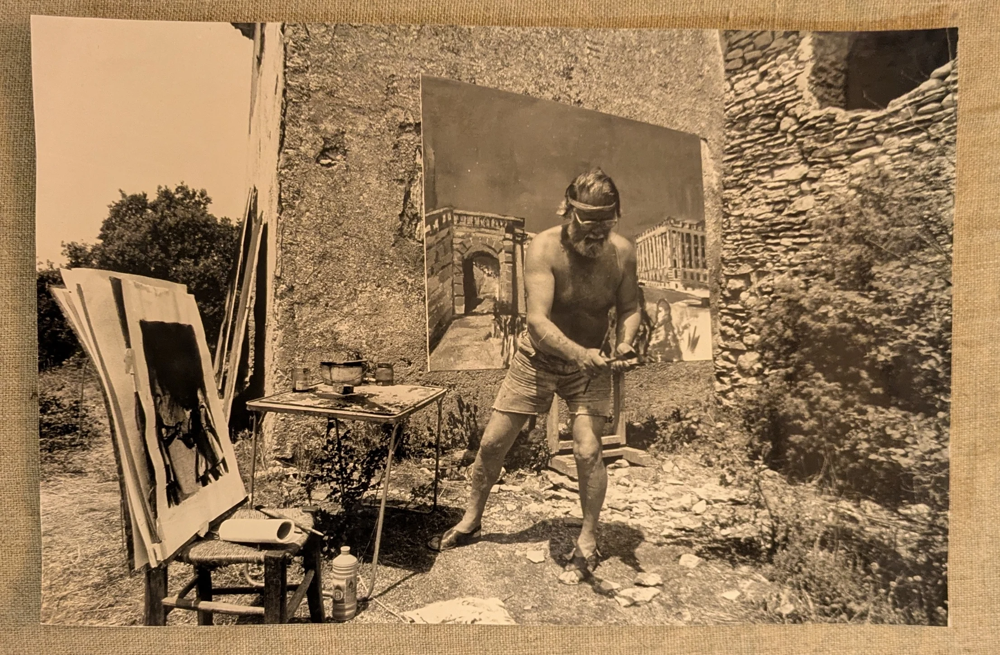
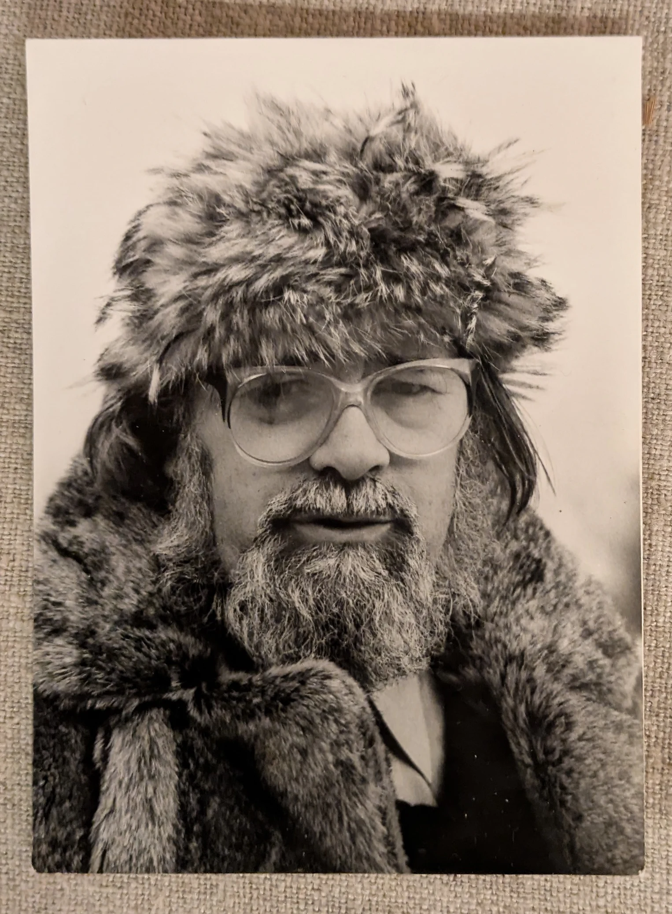
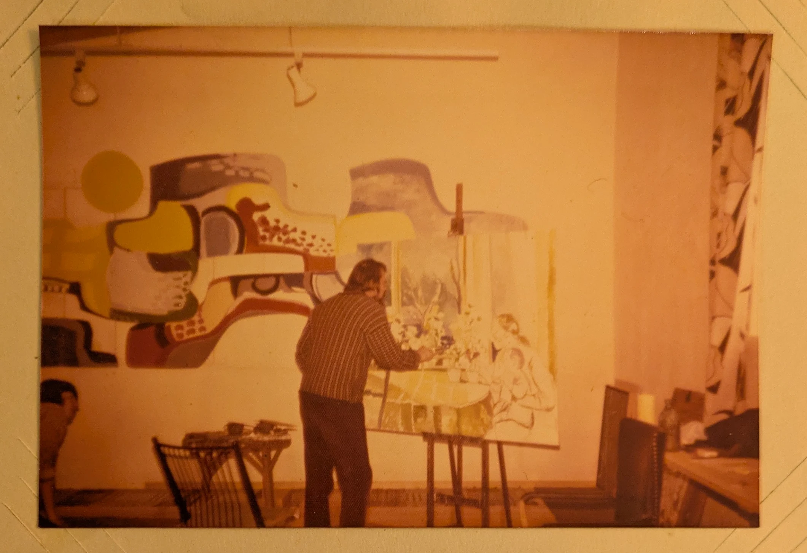
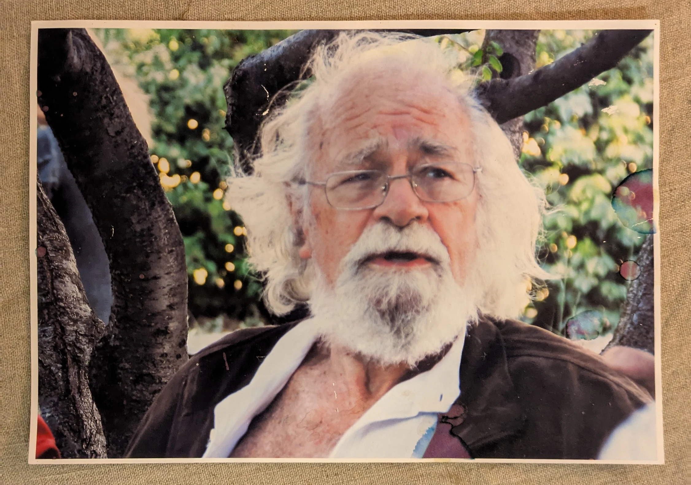

# Stories from _Letters to Joakim_

_Between 1979 and 1981, in Paris and Provence and mostly at four in the morning, my father wrote his life down as a series of letters to "Joakim", a reader who turns out, on the very last page, to be more or less himself. What follows are a few of the stories from that typescript, retold by me, his youngest son, who has the advantage of knowing how they end and the disadvantage of not having been there for any of them._

— Marco ter Haar Romeny

## The museum with an entrance fee

Long before anyone paid to see his paintings, my father charged admission to a bedroom.

As a boy in Usselo, the son (and grandson, and great-grandson) of Dutch parsons, he collected everything the countryside would let him carry home: stones, feathers, birds' eggs, and, at least once, the full olfactory experience of a polecat, which he did not manage to carry home but which, by his account, came with him anyway. All of it went on display across the beds and tables, each item with a little label saying where it came from, and on the back of the door hung a money box. Visiting aunts and uncles, of whom a parsonage has an endless supply, could see "the museum" only after paying a coin.

At fourteen he emptied the box and cycled to Enschede with the entire capital of the enterprise in his pocket, intending, I suspect, to spend it on fish. He stood a long time in front of an aquarium shop. Then he walked on, down the Lasonderstraat, and stopped in front of the window of the Talens paint company, where a reproduction of a Rembrandt self-portrait, the one with the black beret and the moustache and the look of a man about to conquer the world, looked back at him with what Dad called "an almost cheeky self-assurance".

He went in, threw every coin he had on the counter and asked for a palette, brushes, paint and canvas, thinking, in his own words, _damn it, I want to be a painter_. Whether the money covered it he never found out, or never said; he went home loaded with supplies and a pounding heart, slightly alarmed at himself, since nobody in the whole Romeny clan, or among his mother's German relations, had ever done anything but preach, practise law, heal people or drive taxis.

The museum, I'm afraid, closed for good.

## A 3 in natural science

In the middle of the war, in a classroom in Hengelo where the desks rose in tiers like a small amphitheatre and the RAF came by most afternoons to bomb a factory down the road, a teacher read out the results of a science test. Mientje 8, Frans 7.5, Johan 9, and so on through twenty-three children, all of them somewhere between 6 and 9.5. Then a pause, which my father experienced as roughly geological, and then: _Edlef, a 3._

He was the oldest and tallest in the room, having already been held back a year with a crowd of children he had nothing to say to, and he did not take it well. His satchel, full of every schoolbook he owned, left his hands at what he later described as rocket speed, sailed over the heads of his classmates and hit the blackboard, the teacher having, wisely, anticipated it. Dad then left by the door next to his desk, which he slammed hard enough to take out several panes of glass, collected his raincoat on the way, kicked open the headmaster's door to inform him that _enough was enough_, and cycled ten kilometres home to the parsonage, where he locked himself in his room and ignored his stepmother's gentle knocking with the determination of the deeply wronged.

Then his father came up. Barend listened to the whole story, and then, instead of the sermon one might expect from a man who gave them for a living, asked to see his son's drawings.

The next day my grandfather put the lot in a bag, took the train to Arnhem and showed them to the director of the art academy. He came home with the news that Edlef had been accepted, without the entrance exam, as a special case. My father remained grateful for that all his life, and I think the 3 was the best mark he ever got.

## A bridge too far, by bicycle

In September 1944, aged eighteen, my father decided that the most sensible place in occupied Holland to spend the next few days would be Arnhem.

His official reason was that the academy was there and that the widow he lodged with lived in Oosterbeek next door; his real reason, which he admits with some cheerfulness, was a kind of primal urge to be where something big was about to happen. Bicycle tyres were long gone by then, so he rode the ninety kilometres on wheels shod with wooden blocks, _tack, tack, tack, tack_, hiding in ditches from German columns, sleeping in a farmer's barn, and riding straight through Arnhem in the middle of a German round-up of young men without, as far as he could tell, anyone noticing him at all.

The widow looked at him as if a meteor had landed, told him it was terribly dangerous and that school hadn't even started, and put the kettle on.

That was Friday the 15th. On Sunday the 17th, the sky filled with bombers in formations of twelve, and twelve, and twelve, and then someone outside shouted _paratroopers!_ and my father bolted from the lunch table, the widow calling after him, _Edlef, Edlef, your dessert!_, which he considered, even thirty-five years later, the most perfect sentence ever uttered about the Second World War. In the garden the sky was full of parachutes, white, red and yellow, and gliders sliding down behind them. He smoked his first English cigarettes that afternoon.

Then came four days and nights in the cellar. German soldiers searched the house for English soldiers, and two hours later English soldiers searched it for German ones. My father offered his services to the British in return for a rifle, and was thanked and told to go away, which he did, just in time to be a hundred metres off when shells fell on the spot he'd been standing on. When it became too much, he got back on his wooden bicycle, joined the stream of refugees, rode past the German tanks, and knew, with a sinking feeling, how it would end.

Freedom, he wrote, had rung out for four days. He spent the next one picking potatoes for a farmer who wasn't quite sure he wasn't a collaborator.

## The firing squad

After the liberation my father drifted, as nineteen-year-olds did in that strange summer, through a resistance unit and then, for a week, into the military police, complete with a helmet with MP painted on it in white. He found this, for the rest of his life, one of the funniest things that had ever happened to him, and anyone who knew him will understand why.

Two older men in the unit, hardened resistance veterans from Amsterdam, took the young parson's son under their wing, which mostly meant racing around the countryside in an English jeep. Then one day one of them told him, very casually, that two collaborators would be shot that evening, that Edlef was one of the eight men in the firing squad, and that he shouldn't worry too much because one of the eight rifles would have a blank in it, and it might very well be his. See you at seven.

My father ran up every flight of stairs in the police building, burst into the chief's office, and before he could get a word out burst into tears. When he had calmed down enough to speak, all he could say was _never, never this_.

The chief, understandably, wanted to know never _what_. And so it came out: there was no firing squad. It had been a joke, played on the sentimental boy by two men who knew exactly where to press.

He didn't stay long in the police after that. He joined the Marines instead, which tells you something about his idea of a quieter life.

## Eight minutes in New York

The Dutch Marines were trained in North Carolina, and when my father got a week's leave he spent it in New York, on the sixtieth floor of a hotel, with a book of tickets that a grateful America handed out to uniformed allies: the opera, dinner at the Ritz, the Empire State Building, and, at the back of the book, a voucher to record a gramophone message for the folks at home.

He was a country boy from Usselo who had never even been to Amsterdam. He wrote out what he wanted to say, reckoned it would fill the eight minutes nicely, stepped up to the microphone and watched the disc start to turn. The words came out much faster than he'd planned. Halfway through, the letter ran out, the record kept spinning, waiting for him, and he stood there thinking of his father and his brothers and sisters on the other side of the Atlantic, and everything that had happened since the war began, and he couldn't get another word out. And then he cried, onto the record, in the biggest city in the world.

"A man is a man, they say," he wrote, "but sometimes it is hard to steel yourself."

I would give a great deal to know whether that record ever reached Holland, and whether anyone in the family ever played it.

## How to become a war artist

On Java in 1946, my father was a corporal in charge of a machine-gun section, a job for which he had, by his own account, no talent and less interest; he kept forgetting which way was left. So he found an ambitious young man who wanted the job (and the extra pay), marched him to the captain, and asked to demote himself. The captain said _accord_, and Dad tore off his stripes and handed them over on the spot.

The trouble was that he now served under the ambitious young man, which he liked even less, so he hatched a plan. A doctor in America had once told him that the leg he'd hurt in a surfing accident might one day need an operation. So he limped convincingly into the sick bay, was sent to the hospital in Surabaya, took a very pleasant day off in town on the way (while an ambulance drove sixty kilometres to the front to fetch him), and was put to bed, where his temperature chart stayed stubbornly flat.

On the day of the operation, freshly shaved and prepped by a pretty nurse, he asked whether the hospital director, a certain Major Koekebakker of the Marine information service, and the surgeon might just pop by his bed first. A marine first class, summoning a major and a surgeon: it should never have worked. All three came.

He pulled out a folder of drawings and made his pitch. Gentlemen, here lies a former machine-gun corporal who can mow down enemies with the best of them, but before the Marines he was at art school, and if you have any use for an artist to draw the war for the papers back home, he would much rather do that than shoot at these beautiful people; there are surely plenty of others who'll gladly do that part. The gentlemen went off to think about it.

They thought about it, and he became a front-line artist: no command, no orders, a garage for a studio. As far as I know, he never had the operation.

## _Vous êtes un vrai artiste, monsieur_

In August 1948, after the Amsterdam academy had turned him down, my father set off hitchhiking across Europe with a rucksack, a box of watercolours and twenty-five guilders, which he had somehow come to believe was the most you were allowed to take across a border, so of course that is exactly what he took.

In Paris he went straight to the Arc de Triomphe, sat down on a bench and started drawing it. Some ladies on the same bench soon left, but an older gentleman stayed, watched, asked to see the drawing, and then made the sort of gesture only a Frenchman can make, and said: _Vous êtes un vrai artiste, monsieur!_ You are a real artist, sir.

The gentleman was Monsieur Alata, a pianist and composer, and the next day, after a walk around Paris and a glass of wine, he asked my father whether he was hungry, which did not need asking twice. At the family flat in Neuilly there was a grand piano, a Chopin étude, a stern but kind Madame Alata, several children, and a seventeen-year-old daughter with brown eyes and long curls named Lise, whose portrait my father asked to paint in watercolour right after lunch. He later said her smile made the ground sink away under his feet.

He was too young, too Protestant and too broke to do anything sensible about it, and so, naturally, he didn't, and the story went quiet for thirty years. But it is how my father met the woman who would become his second wife, and my stepmother: on a park bench, with a pencil, thanks to a stranger who thought he was a real artist before almost anyone else did.

## A self-portrait for the Kunsthaus

A few weeks later, painting watercolours on a street corner in Zürich, my father was approached by a gentleman who admired his work and asked him to meet him at the station restaurant the next day, since he'd like to buy some pieces.

Dad, who had never sold anything, had no idea what to ask, so he went round the art dealers of Zürich, who sent him from one to the next, until someone suggested he try the director of the city museum, the Kunsthaus. The director looked at the watercolours, said they were worth about fifty Swiss francs apiece, then asked the buyer's name. Brühlmann. _Brühlmann!_ said the director, in a tone my father didn't quite understand, and asked him to come back after the meeting.

At the station restaurant Mr Brühlmann had brought a friend, ordered him a genever (he was Dutch, after all), looked through the folder with stern faces, and offered five francs apiece. My father, who didn't have it in him to haggle, simply packed up and left them sitting there.

Back at the museum he told the director, who exploded, _Dieser verdammte Schwindler!_, that damned swindler, a known hunter of hungry young artists. Then he opened a drawer, took out a fifty-franc note, and handed it over: _I was young once too, and roamed through town and country._

My father, overwhelmed, found the best thing in his folder, a pencil self-portrait, and gave it to the director as a thank-you. The director looked at it and said it would go into the Kunsthaus collection. Weeks after one academy had rejected him, he was in a museum. Years later he came back through Zürich with his family, asked to see it, and found it among the great drawings of Ernst Barlach. He claimed to have been embarrassed, but I don't believe that for a minute.

## The lioness in Antwerp

During his art-school years in Antwerp, my father went to the zoo to draw the lions, and one lioness took one look at him and went berserk: pacing, lashing her tail, glaring straight at him. A small crowd gathered and began, with the speed of a Belgian crowd presented with a Dutchman, to suspect him of having tormented the poor animal. The keeper arrived and asked, quite seriously, whether he was a lion tamer, or perhaps his father had been.

Dad asked to be left alone with her. Closing time was near, so the keeper agreed and retreated to a prudent distance, and my father simply started talking to her, repeating the same few words over and over for about ten minutes. She calmed down, slowed down, padded along the fence and finally rolled onto her back, big paws waving in the air like a house cat's. He admitted to being tempted to scratch her belly. Even he knew where to stop.

The keeper's theory was that someone who looked like my father had once been cruel to her. I prefer my own: that as a small boy in Zeeland, he had watched a circus tamer put his head into a lion's mouth and announced that this was what he would be when he grew up, and that somewhere, somehow, the lioness had heard.

## The ambassador's buttons

In the early sixties my father, still far from making a living from painting, was working as a guard at Långholmen prison in Stockholm, when someone from the Dutch club called to ask whether he'd paint a portrait of the Dutch ambassador, and what it would cost. He asked for a day to think.

He did his thinking the next morning on the prison football pitch, pacing back and forth among his inmates, torn between asking too much and losing the job, or too little and losing his honour. _Three thousand, four thousand, three thousand, four thousand_. In the end he let the buttons on his coat decide, and to be on the safe side the buttons said three thousand. The club man said he was mad, then said to go ahead.

The ambassador, a tall bachelor on Karlaplan with white-gloved servants, posed in full court dress: plumed hat in hand, sword at his side, blue sash, and a breastplate of Orange-Nassau decorations, which my father, with an artist's freedom, rendered somewhat impressionistically. Everyone at home agreed it was clearly the ambassador.

The embassy did not agree. After the summer my father was told, with regret, that the portrait had not been accepted, and was offered a thousand kronor for his trouble. Soon after, he heard a Swedish portraitist named de Geer had painted the official one, which made a certain sense, since the embassy was in the de Geer palace. My father, a man not known for conceding a point, conceded this one: de Geer had done the medals better.

## The last sketch

After a phone call from his sister saying their father was very ill, then another saying he was much better, my father got a third call in his studio in Djursholm: _Edlef, Father is dead._ He said it felt like a violin string snapping.

He arrived in Arnhem at the last minute, with everyone already gathered for the funeral. Someone told him that if he wanted to see his father one last time, he should go now. So he went in, with the only paper he could find, a writing pad, and a pencil.

Barend lay there, heavy and still, hands folded, and my father, who had the habit of recording things by drawing them, drew him fast, very fast, so that nobody would walk in on him doing it, two or three quick sketches, and then hid them and went out to join the others. He wrote that he felt, in some way, satisfied: he had come as a son, but also as an artist. Later he turned the sketches into a small oil painting, in which his father's head slowly becomes a kind of rock in a landscape, so that only he knew who it was.

Years earlier, on an evening walk to post some letters, his father had said to him, out of nowhere, that his second wife was a good woman, _but Mutti, your mother, well ... perhaps you understand ..._ It was the only time he ever said it. My father lost his mother when he was five, and I think he spent much of his life, and quite a lot of paint, trying to get back to that sentence.

